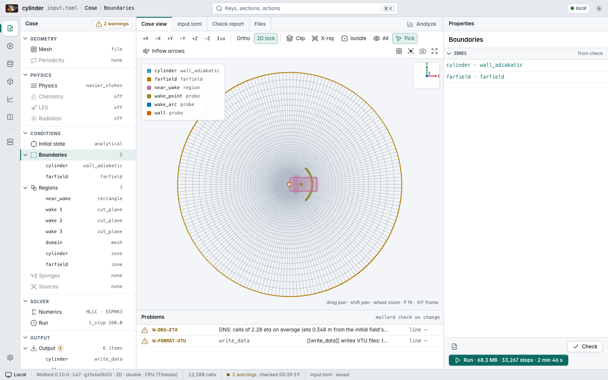
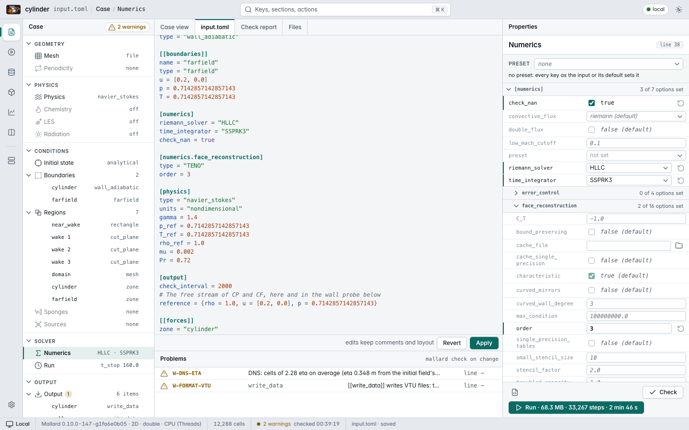
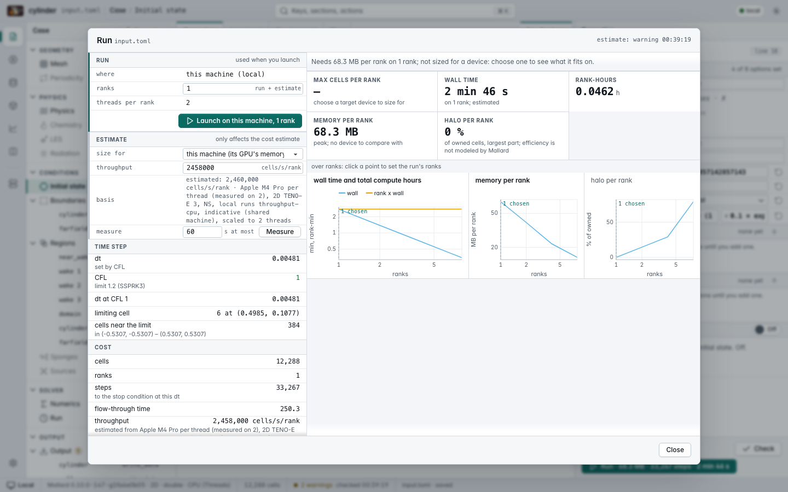
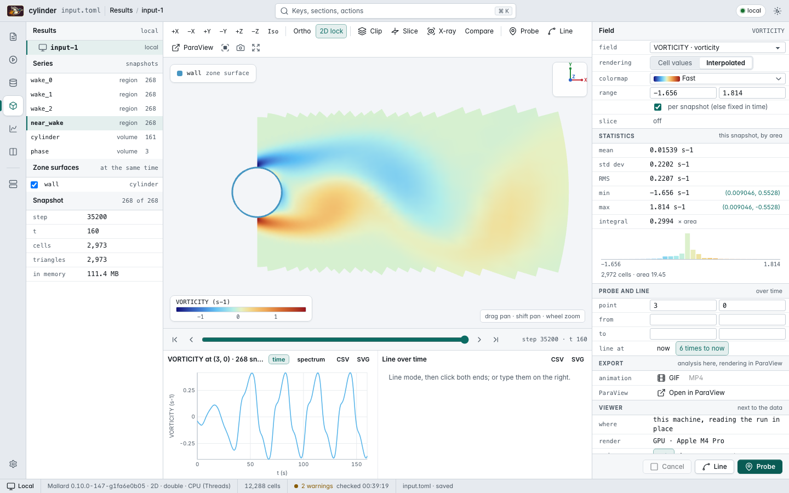

# mallard-gui

- A desktop and browser GUI for the [Mallard](https://github.com/MatthewBonanni/mallard) compressible-flow solver.

| | |
|---|---|
|  |  |
| Case view | Case setup |
|  |  |
| Run dialog | Results |

## Install and run

- **Desktop app (recommended):** download from [Releases](https://github.com/MatthewBonanni/mallard-gui/releases); each bundle carries its own server, so no Python or uv
  - macOS (Apple Silicon): `Mallard-<version>-macos-arm64.dmg` (drag to Applications) or `.zip` (`Mallard.app`)
  - Linux (x86-64): `Mallard-<version>-linux-x86_64.AppImage` (`chmod +x`, run) or `.deb` (`sudo apt install ./…deb`)
  - Windows (x86-64): `Mallard-<version>-windows-x86_64-setup.exe`, an installer
  - `SHA256SUMS`: check with `sha256sum -c SHA256SUMS` (`shasum -a 256 -c` on macOS)
  - Unsigned: macOS (ad-hoc signed, not notarized) blocks the first open until System Settings > Privacy & Security > Open Anyway; Windows SmartScreen warns until More info > Run anyway
- **Browser mode:** the same GUI served to a browser, for remote or headless machines and for development
  - Installs the GUI server only; needs Python ≥ 3.12 and [uv](https://docs.astral.sh/uv/getting-started/installation/)
  - `uv tool install git+https://github.com/MatthewBonanni/mallard-gui`
  - `mallard-gui path/to/case` opens a browser
  - Over SSH: `mallard-gui --no-browser --port 8080` there, `ssh -L 8080:127.0.0.1:8080 host` here
- **Mallard:** either way, the GUI drives a `mallard` build on `PATH` (or `--mallard PATH`, or Settings > Mallard)
  - Install it from Mallard's [installation docs](https://matthewbonanni.github.io/mallard/docs/installation/): container, Spack or from source
  - Mallard runs on Linux and macOS, not Windows
- **Desktop app from source:** [uv](https://docs.astral.sh/uv/getting-started/installation/), Rust, `cargo install tauri-cli --version "^2"` and, on Linux, [Tauri's packages](https://v2.tauri.app/start/prerequisites/)
  - `uv run --group bundle desktop/package.py` writes this OS's bundles and `SHA256SUMS` to `desktop/dist/`
  - Shell-only builds, signing and development: [design notes](docs/design.md)

## What it does

- Case setup: case tree, property inspector with units and presets, `input.toml` editor, `mallard check` on every edit
- Case view: mesh, boundaries, regions and probes with drag handles; boundary, initial-state and mesh-quality overlays
- Runs: cost and memory estimate before launch; live plots, health alerts, Stop, Checkpoint and live key changes
- Results: snapshots viewed where the run is, probes and lines over time, statistics, animations, Open in ParaView
- Analysis: signal statistics and spectra, force coefficients, line and wall extracts, run comparison
- Remotes: SSH (Slurm, PBS, LSF) and Kubernetes, Mallard installs, verified transfers, runs continued or moved there
- No solver logic of its own: keys, defaults, diagnostics and run data come from the `mallard` command line

## Docs

- [User guide](docs/guide.md): set up, check, run, monitor, results, ParaView, settings
- [Design notes](docs/design.md): desktop shell, interface to Mallard, development

## License

- [Apache-2.0](LICENSE)
