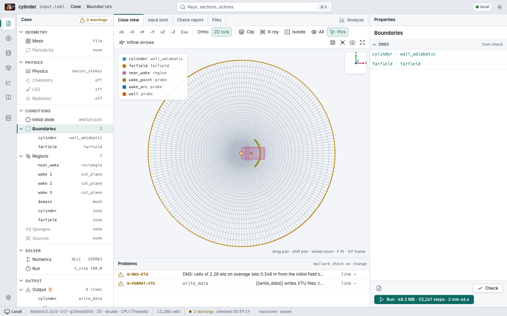
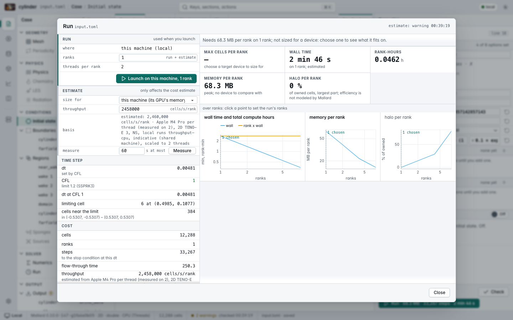
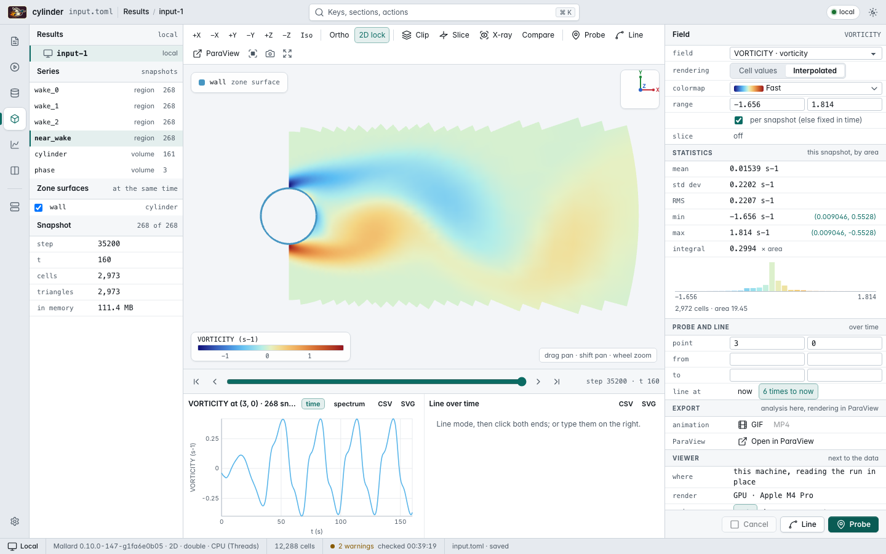

# mallard-gui user guide

Installation is in the [README](../README.md#install-and-run). The GUI drives the `mallard` command line: keys,
defaults, diagnostics and run data all come from Mallard itself.

## Start

```bash
mallard-gui path/to/case               # a directory with an input.toml, or an input file
mallard-gui path/to/new --new          # a new or empty directory, given a starting input.toml
mallard-gui case --input other.toml --mallard ~/mallard/build/bin/mallard --threads 4 --no-browser --port 8080
```

- `--mallard` defaults to Settings, else `$MALLARD`, else one in the GUI's own environment, else `PATH`;
  `--threads` (of local `mallard` commands and runs) to Settings, else 2.
- The server listens on `127.0.0.1` (a random port unless `--port`); its URL carries a per-session token. The
  desktop app runs the same server on the project it was given, else the last one, else asks.
- The rail switches pages: Case setup, Runs, Data, Results, Analysis, Compare runs, Remotes (Cmd/Ctrl+1 to 7)
  and Settings (Cmd/Ctrl+,). The command palette (Cmd/Ctrl+K) finds keys, case-tree nodes and commands.

## Open, save and recover

The input is a document: edits stay in memory until Save (Cmd/Ctrl+S), which writes it in place with comments
and layout kept.

- Undo and Redo (Cmd/Ctrl+Z, Shift+Cmd/Ctrl+Z) step through edits; Revert to Saved is one of them.
- Save As (Shift+Cmd/Ctrl+S) writes another input; outside the project it offers to copy the project's files
  (not its runs) beside it. Open (Cmd/Ctrl+O), Open Recent and New Project (Cmd/Ctrl+N) switch projects.
- Import Mesh (Shift+Cmd/Ctrl+I) sets `mesh.filename`. In the desktop app, dropping a mesh file on the window
  does the same, and dropping a project directory or input opens it.
- Leaving unsaved edits asks Save, Don't Save or Cancel. Run asks Save and Run or Cancel: a run always starts
  from the file on disk.
- Unsaved edits are kept in `.input.unsaved.toml` beside the input and restored by the next session.
- When another program changes the input, the GUI reloads it within 1 s, or, with unsaved edits, asks: Reload,
  Keep Mine (Save then overwrites the file) or Compare (a diff against the file).

## Set up a case



- **Case tree** (left): every section of Mallard's key catalog, with each node's value and its error and
  warning counts. Zones, regions, probes and outputs are child nodes; + adds an entry.
- **Properties** (right): the selected node's keys. Unset keys show their default (or the preset's value) as a
  placeholder; set keys have a reset button; entries have Duplicate and Delete. Hovering a key shows its help.
  A choice of literature models has an (i) button that opens the chosen model's theory section.
  A key that takes several of a list of values (`[particles] forces`) is a checkbox per value, with what each
  does and, where Mallard rates it, its cost (cheap, moderate, expensive) and why; a dropdown shows a value's
  cost beside it.
- **Units**: a dimensional key takes a number in the selected unit, or a quantity such as `1 cm`, which also
  sets the selector. The input stores the SI number; the selector changes only how it is shown. A unit of the
  wrong dimension is an error. Nondimensional cases take plain numbers.
- **Presets**: a section with a `preset` key shows the preset in effect, the keys it fills, and what switching
  would change, as `mallard input resolve` reports them.
- **Boundaries**: zones without a condition show "no condition"; choose one in Properties.
- **`input.toml` tab**: the input as text; Apply applies the edited text, Revert discards it.
- **Files tab**: every file the setup reads, with role, resolved path and size; missing files flagged.

**Case view**: drag to rotate (Shift, or 2D lock, to pan); wheel or pinch zooms toward the cursor.

- Toolbar: view presets (+X … −Z, Iso), Ortho, 2D lock, Clip, X-ray (other zones translucent), Isolate, All,
  Pick (click a zone to select it), Inflow arrows (velocity on inflow faces as Mallard evaluates it; mass-flow
  and stagnation inlets marked as estimates); on the right, mesh edges, frame (Shift+F), PNG and fit (F).
- Regions and probes have drag handles; the input changes on release. A point key can be picked on the view.
- In 3D, the Zones list above Properties toggles each zone's visibility.
- The browser draws up to 2 million surface triangles without a clip; beyond that the server renders images.

## Check a case

`mallard check` runs after every edit (debounced) and on Check. Errors disable Run; warnings do not. The status
beside the Case title counts errors and warnings; click it for the report.

- **Problems** (below the view): code, key and line per diagnostic. Click a row to select its node, the line to
  jump there in the text; double-click for the full diagnostic.
- **Check report** tab: diagnostics with documentation links, then time step, cost, memory, sizing,
  resolution, mesh quality, boundaries, regions and environment. Rows link to their key or node; rows with a
  location (the cell limiting dt, a worst cell, the largest y+) mark it on the case view.
- **Analyze** (beside the tabs): overlays from `mallard check`. Boundaries: unassigned faces, Normals, Wall y+
  (largest, mean, target), periodic pairs. Initial state: any initial field, with colormap and range. Mesh
  quality: a histogram per metric; click a bin to select its cells, or Worst cells.

## Run on this machine



Run (bottom right of Case setup) opens the Run dialog.

- **RUN**: ranks (`mpirun -n` above 1) and threads per rank (from Settings); "Launch on this machine" starts it.
- **ESTIMATE** (cost only): the memory per rank to size for (this machine or a GPU model) and throughput in
  cells/s per rank, by default from this project's earlier runs, else Mallard's published table. Measure times
  steady stepping on one rank here until the median is known to ±3 % or the time limit is reached.
- The right column shows max cells per rank, ranks to fit, wall time, rank- or GPU-hours, memory per rank, and
  plots against rank count; click a point to set the ranks.

Each run gets `runs/<input>-<N>/`, with a copy of the input that sets `run.control_file_interval` (for Stop and
Checkpoint) and makes relative file paths absolute. A run outlives the GUI; the next session picks it up.

## Monitor a run

Select a run on the Runs page.

- **Stop** writes a `STOP` control file (a restart and the final output, then exit); **Checkpoint** a `CHECKPOINT`.
- **Continue** resumes a run that ended stopped, by signal or at its wall-time limit, in its own directory from
  its last restart (SHA-256 checked first); its run log, CSV files and snapshot series are appended to.
- **Restart from** starts a new run of the case's current input from this run's last restart.
- **Plots**: four live plots, each with a chosen source (dt, CFL, monitors, forces, probes, reductions). Wheel
  zooms (Shift for y), drag a box, pan; a zoom pauses following and loads full-resolution data, and a
  double-click resumes.
- **CSV** and **SVG** on this and every other page's plots save to `exports/<run>/`: the plot's data (or a
  probe file's every sample, with units), or a light and a dark figure in Mallard's documentation style.
- **Events**: the run log (`mallard.jsonl`). **Log**: `stdout.txt`. **Control**: keys a running local run takes
  (CFL, output intervals, stop time), applied from the next step. **Outputs**: snapshots and restarts.

**Health** lists alerts as they occur: Mallard's own warnings (such as `W-HEALTH-MARGIN`), its divergence report
and end record, then the GUI's checks:

| Alert | Condition |
|---|---|
| NaN or Inf | a progress value turns `null`, or a non-finite value appears in a probe, force or reduction file |
| CFL | above the time integrator's limit, or above 2× its recent median |
| dt collapse | below 0.1× its recent median |
| stalled | no progress record for 10× the usual interval (at least 2 min) while the job runs |
| diverging | a `max_*` monitor or the conservation-ledger residual grows 100× over 6 rows |
| wall time | past 90 % of `[run] t_wall_stop` (or the job's limit), or the ETA beyond it |

A GUI alert repeats only after its condition has been clear for 5 rows. Alerts show as toasts and, with
**Notify** on, as desktop notifications. **Auto-action** stops the run with a restart on a critical alert or on
any alert, while the GUI is open. Both are per run; a new run takes the last values set in its project.

## Run on a remote

The Run dialog launches on this machine. A run reaches a remote through the Data page: Continue starts a new
run there from an existing run's restart; Move makes the remote the run's home. The Remotes page sets remotes
up, in `remotes.toml` in the config directory ([Files](#files)).

- **Add**: name; host (an alias from `~/.ssh/config`; keys, agents and MFA stay with OpenSSH); backend (`slurm`,
  `pbs`, `lsf`, or `k8s`); run root; install root; job defaults (partition or queue, account, time, gres, CPUs,
  memory, GPUs).
- **Test connection**: times a round trip and reports the login node's system, glibc, scheduler, partitions,
  modules, Apptainer, Spack, and Mallard installs (on `PATH`, in modules, under `~/mallard/*/`); Use records one.
- **Queue**: your jobs (`squeue --me`, `qstat -u $USER`, `bjobs`, or the GUI's Jobs in the namespace).
- **Install…** shows what will run and runs nothing until you confirm. Methods in order: the release's archive
  for the login node's architecture and variant (`cpu`, `cuda12`, `cuda13`, `rocm`), SHA-256 checked; the
  release image through Apptainer; a Spack build with the site's compilers and MPI, as a batch job. Installs
  sit side by side in `<install root>/mallard/<version>-<variant>/` (default root: home); the first is default.
- **Verify** runs `mallard install verify` as a short job. **Upgrade** installs a version beside the default,
  verifies it, and makes it the default only if it passes. **Remove** deletes an install the GUI made;
  **Forget** only drops it from the list.

**Kubernetes**: the host is a kube context, the install a Mallard image (such as
`ghcr.io/matthewbonanni/mallard:0.10.0-cpu-amd64`), and runs are Jobs on a PersistentVolumeClaim (no retries,
kept 7 days); job defaults are `cpu`, `memory`, `gpu`, `gpu_resource` and `time`. Commands and transfers go
through a helper pod, deleted when idle. `[remotes.<name>.k8s]` in `remotes.toml` sets `namespace`, `pvc`,
`mount` (default `/data`), `prefix` (`mallard-gui`), `node_selector` (`key=value,…`), `run_as_user`, and the
helper pod's `idle` (120 s) and `deadline` (14400 s).

**Data page**: a run's files at each location, with their state: `home`, `present`, `prefix` (a shorter copy of
a growing file), `partial` (an interrupted transfer) or `absent`.

- **Select**: One snapshot, Time range, "Probes, forces, integrals", Newest restart, Case inputs, Whole run, or
  individual files.
- **Transfer** to a destination (`runs/<run>` here, `<run root>/<run>` on a remote) by a route: this machine and
  a remote, remote to remote through this machine's memory, directly between SSH remotes, or in place on shared
  storage. The plan shows what moves, what is already there, and an estimate from measured throughput. Copies
  land as `.partial`, are renamed once their SHA-256 matches, and resume after an interruption.
- **Check restart** has the destination's `mallard` read the newest restart, which must match the run's
  format, dimension, precision, cells, fields and species. **Continue** then starts a new run there from it.
- **Move** copies and verifies the whole run and makes the destination its home; the old copy stays until
  Remove old home.

## Look at results



The Results page opens any snapshot of a run where the run is, without copying it.

- **Left**: runs, series, zone surfaces shown alongside, particles, the snapshot's details. Below: a time bar.
- **Toolbar**: view presets, Ortho, 2D lock, Clip, Slice (computed where the data is), X-ray, Compare (a second
  view, same camera, another field), Probe, Line, ParaView, frame, PNG, fit.
- **Field**: field, component, rendering (Cell values or Interpolated; probes, lines and statistics always use
  cell values), colormap (ParaView's presets, Fast by default), range (per snapshot or fixed in time).
- **Statistics**: the field over the domain or slice, volume-weighted (area in 2D), with a histogram; click
  the min or max location to probe there.
- **Probe and line**: Probe, then click the view or type a point, for the field there over every snapshot (at
  most 400) and its spectrum. Line takes two points: the field along it now or at several times.
- **Saved views**: camera, field and probe by name, in the project file.
- **Jobs where the run is**: Diff (`mallard diff` with another snapshot), Average (`mallard post average` over a
  time window), Slice (`mallard post extract` of the section plane), Surfaces (decimated, written beside the
  data). Average and Slice results open as new series.
- **Export**: the view over every snapshot (at most 240 frames) as GIF, or MP4 with `ffmpeg` on `PATH`.
- A volume over 5 million cells shows its zone surfaces and offers a parallel viewer job (Start it); surfaces
  over 2 million triangles are decimated.

**Viewer**: the GUI process reads local runs; a viewer job next to the data, one per remote, reads remote runs
and exits when the GUI closes or after 900 s idle. If none starts, the page says why and offers Use the login
node or Batch images. Mode: Auto, Images (rendered next to the data) or Geometry (drawn in the browser).
`[remotes.<name>.viewer]` in `remotes.toml` sets `python` (default `viewer/bin/python` beside the default
install), `partition`, `account`, `time` (`01:00:00`), `cpus` (2), `idle` (900 s), `max_ranks` (parallel
viewer) and `launch` (`auto` tries `srun`, `allocation`, `node`; or `login`). On Kubernetes the viewer is a pod
reached through `kubectl port-forward`, which also takes `image`, `memory` (`4Gi`), `libs` (a `.tgz` of shared
libraries such as OSMesa) and `opengl` (`osmesa` or `egl`).

### Analysis

The Analysis page reads a run's own files, so zooms and exports reach every sample.

- **Histories**: any of the run's signals on one plot, with units and a running mean.
- **Signal**: one signal over a window (from/to t, "after transient" by MSER-5, all, or dragged): mean and RMS
  with 95 % intervals from batch means, autocorrelation time, convergence of the mean, the Welch spectrum with
  its peak and Strouhal number, and the autocorrelation.
- **Forces**: Cd, Cl (Cs in 3D), pressure and viscous parts, against reference density, velocity, length, area
  and angle (defaults from `[output].reference`; values take units, such as `40 cm/s`), with means,
  intervals, fluctuations and the lift's Strouhal number.
- **Lines and walls**: `mallard post extract` of a line or a wall (Cp, Cf, y+ against arc length) from a
  restart or whole-mesh snapshot, where the run is; axes take any unit, or x/L.

### Compare runs

Pick two runs: their inputs side by side as Mallard resolved them, differing keys highlighted (Changed only hides the
rest), and an Overlay of one probe, force or reduction column from both. REFERENCE DATA adds a CSV file as
points: first column x, other columns curves, optional header row, `#` comments.

## Hand off to ParaView

ParaView on the Results toolbar (Shift+Cmd/Ctrl+P) writes a state of the shown series, with time, field,
component, colormap, range, camera and section plane, to `exports/<run>/` and opens it. It is enabled once
ParaView is found: `$MALLARD_GUI_PARAVIEW` (executable or `.app`), else `paraview` on `PATH`, else the newest
`/Applications/ParaView*.app`. Without `pvpython` beside ParaView, the state is a Python script. Remote runs
must be copied here first (Data page).

## Settings

Each change is saved immediately to `settings.toml` in the config directory. A file that does not parse is
never overwritten; the GUI says why and uses defaults.

- **Appearance**: Theme (System, Light, Dark); Panes: Reset sizes.
- **Units**: per quantity, the unit an empty field starts in.
- **Runs**: Threads of local `mallard` commands and runs; Copy runs to (the Data page's default destination).
- **Notifications**: Notify by default; Alerts (warnings and critical, or critical only); When a run ends.
- **Mallard**: the front end, which runs `mallard2d` or `mallard3d` by the case's dimension, and optionally a
  2D or 3D executable (a build tree's `src/mallard`) that runs that dimension's cases instead.
- **Recent projects**, with Clear.

## Files

| Path | Contents |
|---|---|
| `mallard-project.toml` | the project's inputs and saved views (written on first open) |
| `mallard-runs/<run>.toml` | each run's record: home, input SHA-256, Mallard version, job |
| `runs/<run>/`, `exports/<run>/` | local run directories; exports and ParaView states |
| `~/.config/mallard-gui/` | `settings.toml`, `remotes.toml`, `page.log` (`$MALLARD_GUI_CONFIG_DIR` overrides; on Windows, the user config directory) |
| user cache directory (`~/.cache/mallard-gui/` on Linux) | `health.toml` (per-run alert settings), `index.sqlite` (where copies are, transfers, throughput) |

`page.log` records page errors, lost WebGL contexts and rendering-mode changes as JSON lines, with the previous
1 MB in `page.log.1`. Attach it to a report of a view that stopped drawing.
